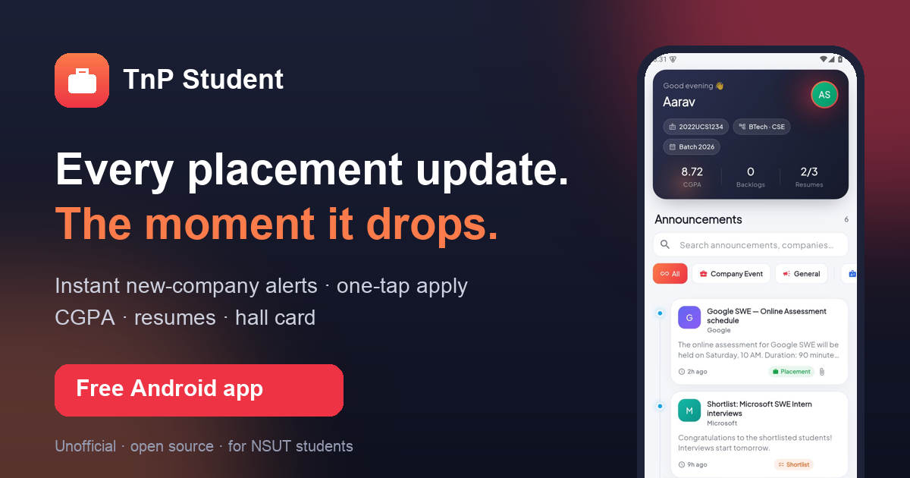
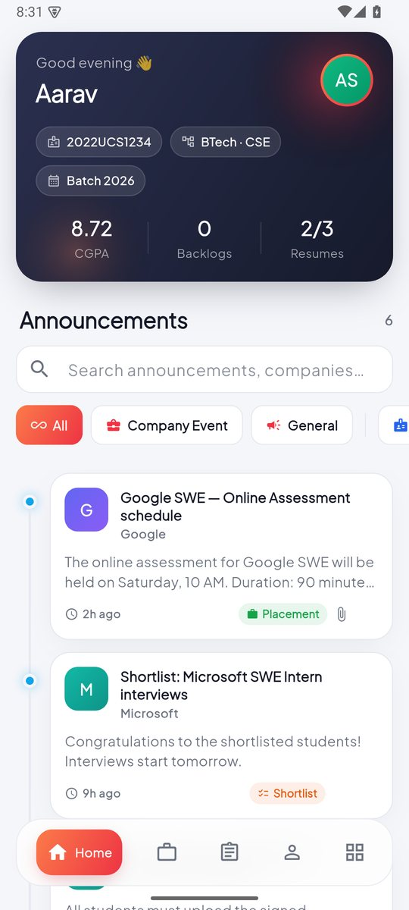
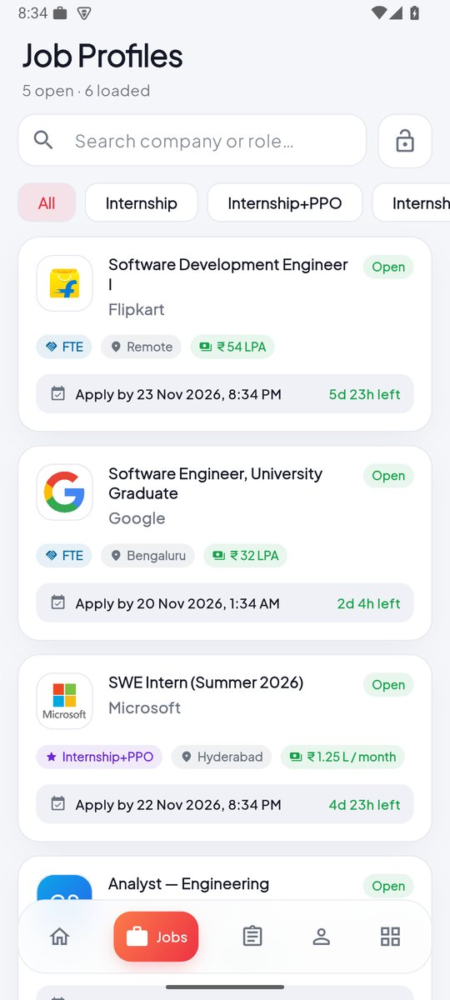
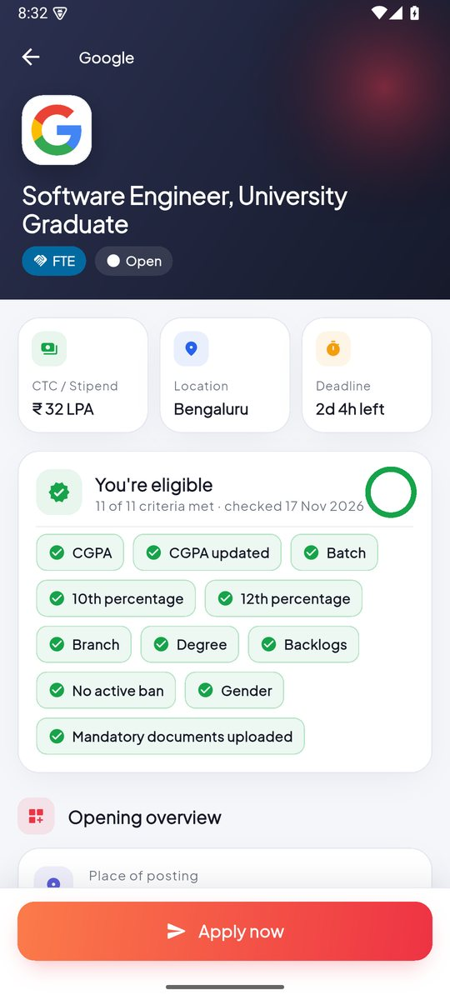
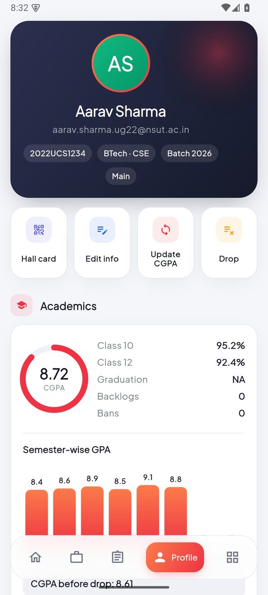
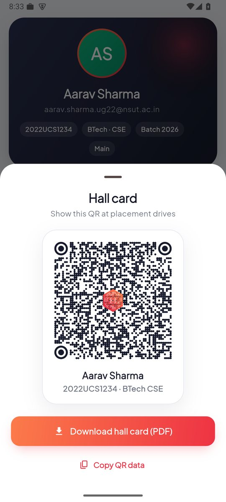
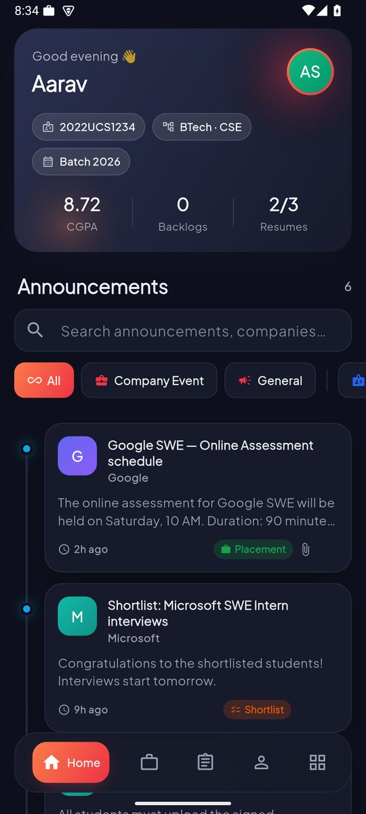
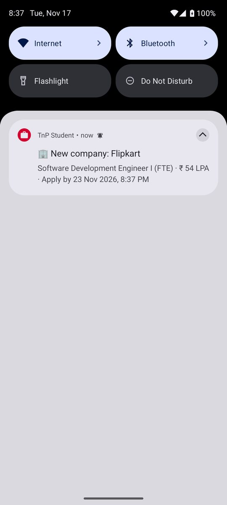

<p align="center">
  
</p>

<h1 align="center">TnP Student</h1>

<p align="center">
  Unofficial, open-source Android app for NSUT students on top of the Training &amp; Placement portal.<br/>
  <a href="https://github.com/urraf/tnp-student/releases/latest/download/TnP-Student.apk"><b>⬇️ Download APK</b></a>
  &nbsp;·&nbsp;
  <a href="https://tnp.nahraf.tech/">Website (tnp.nahraf.tech)</a>
  &nbsp;·&nbsp;
  <a href="RELEASING.md">Releasing</a>
</p>

## Screenshots

<p align="center">
  
  &nbsp;
  
  &nbsp;
  
</p>
<p align="center">
  
  &nbsp;
  
  &nbsp;
  
</p>
<p align="center"><sub>Home · Openings · Eligibility · Profile · Hall card · Dark mode — shown with sample data</sub></p>

## Features



- **New-company alerts** with their own chime — checks every 15 minutes even when the app is
  closed (exact wake-up alarms that survive Doze and reboots, WorkManager as backup)
- **One-tap apply** with a full eligibility check, resume picker and the company's questions
- **Announcements** timeline with search, tags and in-app attachments
- **Profile** — CGPA sync, semester GPA chart, drop-subject planner, up to 3 resumes
- **Hall card** with QR code and PDF download
- **Forms, NOC & feedback**
- **Light & dark themes**
- **Self-updating** from GitHub Releases — students get a notification and update in a tap

The app talks only to the official portal (`api.tnpnsut.in`, the same backend as
student.tnpnsut.in). No extra server, no analytics, no ads.

<br clear="right" />

## Run

```bash
flutter run                                   # real portal
flutter run --dart-define=DEMO=true           # offline sample data, no account needed
flutter run --dart-define=DEMO=true --dart-define=ALERT_MINUTES=2   # faster alert testing
flutter test
flutter build apk --release                   # signed with android/key.properties (see RELEASING.md)
```

## Project layout

```
lib/core/     config, theme, API client, router, alerts (background checks), updater, system bridge
lib/data/     models + repository (one method per portal endpoint)
lib/state/    auth and feeds (Riverpod)
lib/ui/       screens and widgets
android/app/src/main/kotlin/…/MainActivity.kt   battery/autostart/installer bridge
docs/         download website (GitHub Pages)
```

## Credits

Designed & developed by **Farhan** · [nahraf.tech](https://www.nahraf.tech)

Not affiliated with, endorsed by, or operated by Netaji Subhas University of Technology or its
Training &amp; Placement cell.
